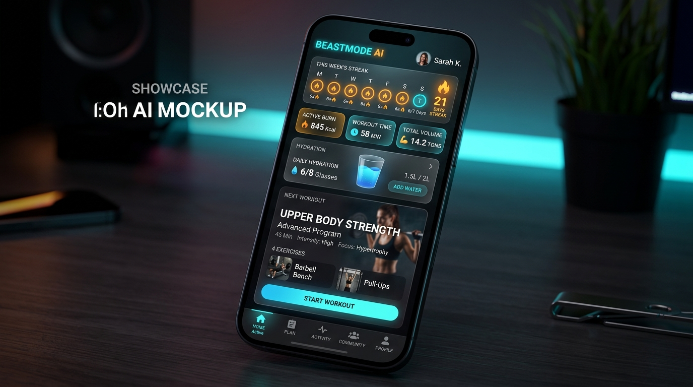
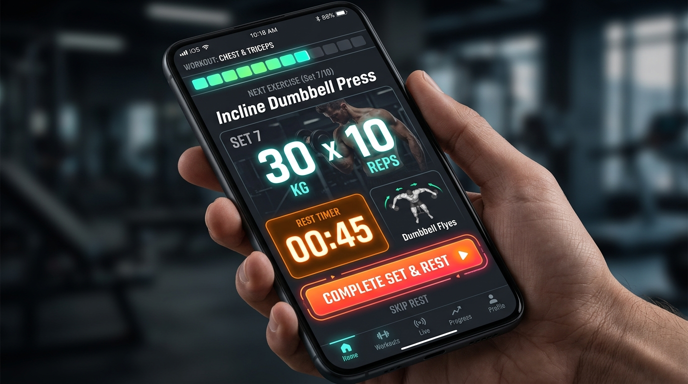
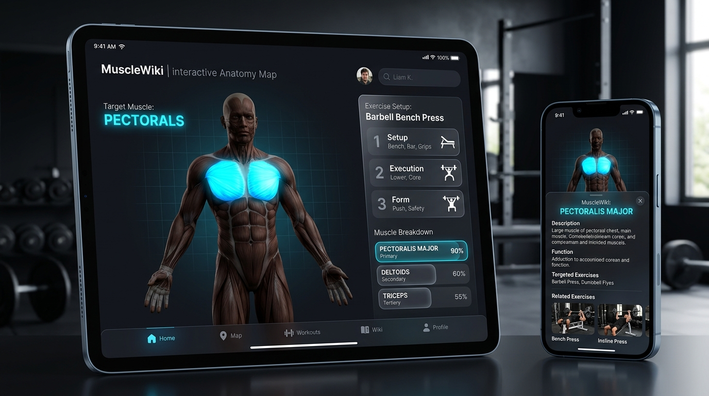
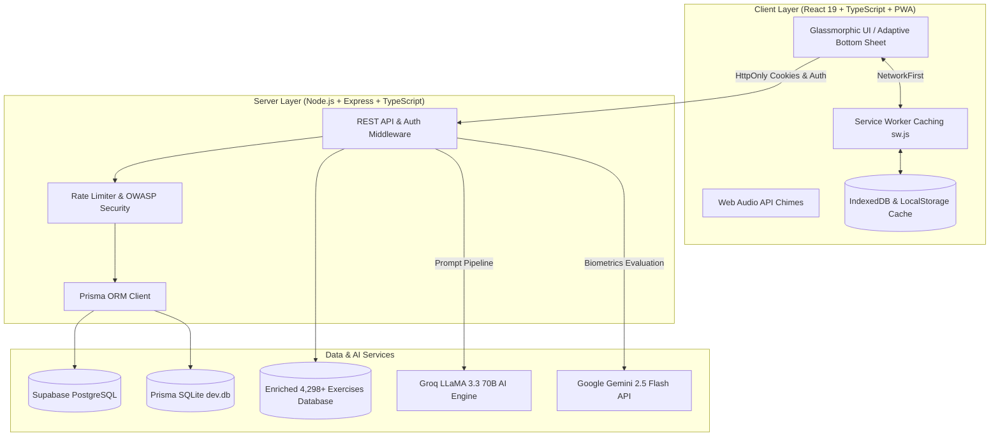

# 🦍 BeastMode AI — Next-Gen Smart Fitness & Nutrition Ecosystem

<p align="center">
  <a href="https://fit.mkhateeb.com" target="_blank">
    
  </a>
  
  
  
  
  
  
  
  
</p>

---

## 🌐 Live Production Deployment

Experience the live, production-hardened progressive web application on the official domain:

<p align="center">
  <a href="https://fit.mkhateeb.com" target="_blank">
    <b style="color: #00d2ff; font-size: 22px;">🚀 Launch BeastMode Live App</b><br />
    <code>https://fit.mkhateeb.com</code>
  </a>
</p>

---

## 📸 Interface & Live Experience Showcase

<p align="center">
  
</p>

<p align="center">
  <em>⚡ Streamlined Glassmorphic Dashboard: Focused Today's Workout, Zero-State Metrics, Quick Daily Actions & Weekly Streak Bar.</em>
</p>

<br />

<table align="center" width="100%">
  <tr>
    <td width="50%" align="center">
      
      <br />
      <b>🏋️ One-Thumb Gym Player & Target Set Completion</b>
    </td>
    <td width="50%" align="center">
      
      <br />
      <b>🗺️ 3D Muscle Anatomy & 4,117+ Exercise Catalog</b>
    </td>
  </tr>
</table>

---

## 🌟 Key Features & Architectural Highlights

### 1. 🏋️‍♂️ One-Thumb Gym Player (Zero-Latency Live Session)
* **Target Set Completion (`targetSetIndex`)**: Complete any individual set directly from the row with instant tactile feedback, without forcing set progression order.
* **Smart Auto-Fill Weights**: Automatically propagates logged weight and reps to subsequent sets to eliminate repetitive gym data entry.
* **Accurate Completion Summary**: Displays real completed vs total exercises ratio (`completedCount / totalExercises`) upon finishing the workout.
* **Native Offline Audio Chimes**: Web Audio API synthesized chimes for rest timer countdowns (0 KB network footprint, 100% offline).

### 2. 🛡️ Production-Grade Security & OWASP Hardening
* **CSPRNG Cryptographic OTP**: 6-digit one-time password generation powered by `crypto.randomInt` with automatic Brute-Force lockout (invalidates token after 5 failed attempts).
* **Guarded Google OAuth Linking**: Enforces cryptographic verification and requires current password verification before linking accounts.
* **Strict CORS & Domain Isolation**: Restricts credentialed cross-origin access exclusively to verified domains (`fit.mkhateeb.com` and production Vercel subdomains).
* **Tiered Rate Limiters**: Dedicated `authLimiter` (10 req / 15 min) and `aiLimiter` (20 req / 15 min) to prevent credential stuffing and token exhaustion.
* **Zero-Leak Response Policy**: Completely eliminated all `debugOtp` and client-side `sessionStorage` token fallbacks.

### 3. ⚡ Optimized AI Engine & Token Conservation (Gemini 2.5 Flash)
* **Zero-Waste Schema Execution**: Optimized structured JSON schema calls with `thinkingBudget: 0`, saving **512–1,024 expensive output tokens per generation**.
* **Disk-Persisted Exercise Translations**: Writes Arabic exercise translations permanently to disk (`exercises_backup.json`), preventing repetitive LLM translation calls across server restarts.
* **LRU-Cached Inferences**: Smart cache layer caching bulk imports, workout upgrades, and physique assessments by input hash.
* **Bounded Input Protection**: Strict 8,000-character caps on unstructured workout inputs to prevent token depletion attacks.

### 4. 🗺️ Interactive 3D Muscle Anatomy & 4,117+ Exercises
* **Instant Add-to-Plan**: One-click addition from `MuscleWikiModal` directly into the currently active workout day without state collisions.
* **Dual Front/Back SVG Heatmap**: Dynamically highlights primary agonist muscles in bright neon and secondary synergist stabilizers in muted hues.
* **Smart Warmup & Cooldown Routines**: Context-aware dynamic warm-up and recovery exercise recommendations matching targeted muscles.

### 5. 📊 Biometrics, Nutrition & Analytics
* **Gender-Calibrated Nutrition Calculator**: Accurate Mifflin-St Jeor BMR/TDEE calculations supporting all uppercase/lowercase gender representations (`MALE`/`FEMALE`).
* **True Zero-State Metrics**: Clean `0 kcal`, `0 min`, and `0.0 Ton` baselines for new athletes without inflated mock baselines.
* **Multi-Set Weight Parsing**: Robust comma-separated weight parsing (`15kg, 20kg`) ensuring clean progression curves without string concatenation bugs.
* **Localized Weekly Streak**: Timezone-aligned weekly streak calculation avoiding UTC date shifts in Middle Eastern and European timezones.

### 6. 📱 Offline-First PWA (Progressive Web App)
* **100% Offline Resilience**: Operates seamlessly in gym basements using IndexedDB, LocalStorage, and Service Worker cache tiers.
* **Dual-Storage Cloud Sync**: Seamlessly syncs between browser local storage and Supabase PostgreSQL tables (`User`, `WorkoutPlan`, `DayWorkout`, `Exercise`, `WeightLog`, `ProgressLog`).

---

## 🎨 4 Curated Visual Aesthetics

BeastMode features a dynamic runtime theme switcher tailored to high-contrast training environments:

```
1. ⚡ Cyber-Volt & Carbon   (#CCFF00) - Maximum visual energy, high-contrast neon accents.
2. 🔥 Crimson Iron & Fire   (#FF1744) - Aggressive raw strength and powerlifting focus.
3. 👑 Imperial Gold & Onyx  (#F59E0B) - Mr. Olympia championship aesthetic.
4. 💎 Cyber Frost & Cyan    (#00D2FF) - Sleek biometric bio-hacking glassmorphism.
```

---

## 🏗️ System Architecture



---

## 🛠️ Technology Stack

| Domain | Technology | Purpose |
| :--- | :--- | :--- |
| **Frontend Framework** | React 19 + TypeScript | High-performance SPA with modern hooks and transitions |
| **Styling & Design** | Vanilla CSS Custom Properties | Custom Glassmorphism design system (Zero Tailwind/Shadcn lock-in) |
| **Build & Bundler** | Vite 6 + Rolldown | Sub-second Hot Module Replacement (HMR) and optimized chunking |
| **Icons** | Lucide React | Clean, scalable vector iconography |
| **Backend Runtime** | Node.js + Express + TypeScript | Type-safe RESTful API services |
| **ORM & Database** | Prisma + PostgreSQL / SQLite | High-speed relational querying and schema integrity |
| **AI Engines** | Groq LLaMA 3.3 70B & Gemini 2.5 | Realtime plan generation, exercise swaps, and biometrics critique |
| **PWA & Offline** | Service Worker + Web Manifest | Standalone mobile application feel with offline resilience |

---

## 🚀 Local Development Quickstart

### Prerequisites
* Node.js `>= 18.0.0`
* npm `>= 9.0.0`

### 1. Clone the Repository
```bash
git clone https://github.com/Mak241288/New-Beast-Mode.git
cd New-Beast-Mode
```

### 2. Configure Environment Variables

**Backend (`backend/.env`):**
```env
PORT=5000
JWT_SECRET=your_super_secret_jwt_key
DATABASE_URL="file:./prisma/dev.db"
GROQ_API_KEY=your_groq_api_key
GEMINI_API_KEY=your_gemini_api_key
CLIENT_URL=http://localhost:5173
```

**Frontend (`frontend/.env`):**
```env
VITE_API_URL=http://localhost:5000/api
VITE_SUPABASE_URL=https://your-project.supabase.co
VITE_SUPABASE_ANON_KEY=your-supabase-anon-key
```

### 3. Install Dependencies & Initialize Database
```bash
# Backend Setup
cd backend
npm install
npx prisma db push
npm run build

# Frontend Setup
cd ../frontend
npm install
npm run build
```

### 4. Run Development Servers
```bash
# Terminal 1 - Backend API Server
cd backend
npm run dev

# Terminal 2 - Frontend Client
cd frontend
npm run dev
```

Open your browser at `http://localhost:5173`.

---

## 🧪 Testing & Verification Suite

BeastMode maintains strict testing protocols across unit and integration levels:

```bash
# Run Frontend Vitest Test Suites
cd frontend
npm test -- --run

# Verify Frontend Production Build
npm run build

# Verify Backend TypeScript Compile
cd ../backend
npm run build
```

---

## ❓ Frequently Asked Questions (FAQ)

<details>
<summary><b>Q1: Does BeastMode require an active internet connection in the gym?</b></summary>
<br />
No. BeastMode is engineered as an offline-first Progressive Web App (PWA). Once loaded, your active workout plan, exercise database, and stopwatch timers operate completely offline. Any completed sets are saved locally and automatically synchronized with the cloud once connectivity is restored.
</details>

<details>
<summary><b>Q2: How does the AI generate personalized progressive overload?</b></summary>
<br />
The AI analyzes your logged tonnage volume, RPE (Rate of Perceived Exertion), completed reps from prior sessions, and body measurements. If you consistently hit the upper rep range with good form, it automatically adjusts your target loads by calibrated +2.5kg increments.
</details>

<details>
<summary><b>Q3: Can I install BeastMode as a native app on iPhone and Android?</b></summary>
<br />
Yes! On Android, tap the "Install App" button in the prompt. On iPhone, open the app in Safari, tap the Share button (⎋), and select "Add to Home Screen (➕)".
</details>

<details>
<summary><b>Q4: How does BeastMode handle privacy and health data?</b></summary>
<br />
All authentication tokens are transmitted via secure, HttpOnly, SameSite=Lax cookies with bcrypt password hashing. User data is never sold or used for third-party advertising.
</details>

---

## 📜 License & Acknowledgments

This project is licensed under the MIT License. Exercises data and anatomical references inspired by open sports science research, MuscleWiki, and the global athletic community.

<p align="center">
  <b>Built for athletes. Engineered for performance. Activate BEASTMODE. 🦍⚡</b>
</p>
